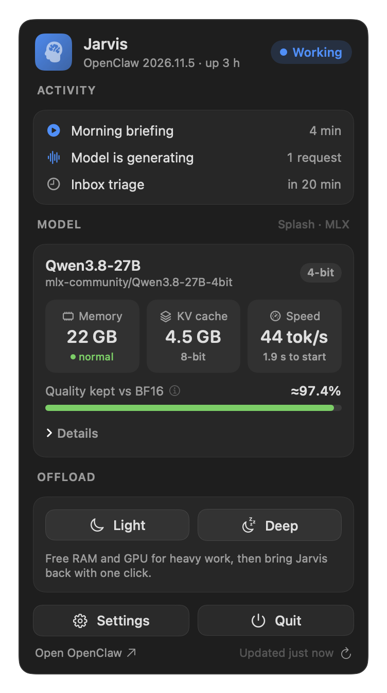
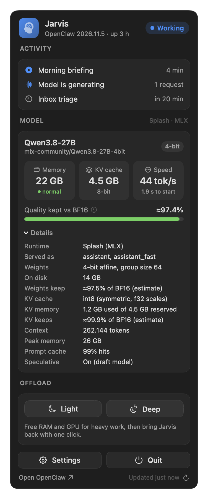
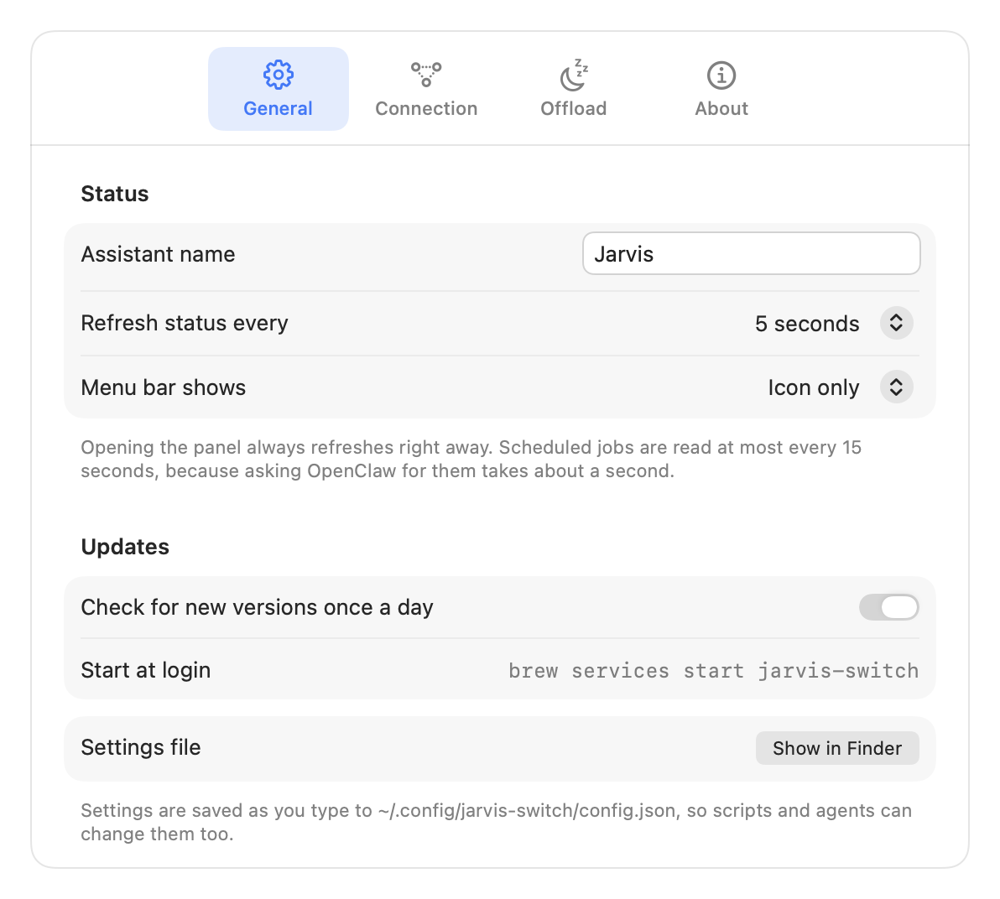

# Jarvis Switch

A small, native macOS menu-bar app for people who run their own AI assistant on a Mac with
[OpenClaw](https://docs.openclaw.ai) and a local model.

One click on the menu-bar icon shows whether your assistant is idle or working, what it is running, and
which model is loaded: memory, KV cache, speed, and roughly how much quality the quantization keeps
compared with the full-precision (BF16) model. When you need your RAM and GPU back for something heavy,
it can offload the model and bring it back.

<p align="center">
  
  
</p>

The menu-bar icon tells you the state without opening anything: a head while idle, a filled head while
working, a moon while offloaded, a warning triangle when the OpenClaw gateway is down. Optionally it shows
the state as a word next to the icon.

## Install

```bash
brew install mertegemencaliskan/jarvis/jarvis-switch
brew services start jarvis-switch
```

Homebrew builds it from source on your Mac (it needs the Xcode Command Line Tools:
`xcode-select --install`). `brew services` starts it at login and restarts it if it crashes.

Update:

```bash
brew upgrade jarvis-switch && brew services restart jarvis-switch
```

The panel shows a banner when a newer version is out (checked once a day against GitHub releases; you can
turn this off in Settings).

Without Homebrew: clone the repo and run `scripts/build.sh`, which builds `build/JarvisSwitch.app`.

## The panel

- **Header**: the assistant's name, OpenClaw version and uptime, and a status pill: Idle, Working,
  Resting (model weights released), Offloaded or Offline.
- **Activity**: the scheduled jobs running right now and for how long, whether the model is generating,
  the next job, and any job whose last run failed. Only what is relevant is shown.
- **Model**: the model and its weight bit width, three tiles (memory with system memory pressure, KV cache
  size and bit width, decode speed with time to first token) and a bar for the estimated quality kept
  versus BF16. **Details** opens the rest: weight quantization and size on disk, KV format and use,
  context window, peak memory, prompt-cache hit rate, speculative decoding and served model names.
- **Offload**: Light and Deep buttons, and Bring back while offloaded (shown only if you set it up).
- **Settings** and **Quit**, plus **Open OpenClaw** and a refresh button.

<p align="center"></p>

## Settings

Open **Settings** from the panel (⌘,).

<p align="center"></p>

- **General**: assistant name, **how often the status refreshes** (2 seconds to 15 minutes), icon only
  or icon and status in the menu bar, daily update check.
- **Connection**: the OpenClaw config file, the `openclaw` command, gateway and model-server addresses,
  and what **Open OpenClaw** runs. Leave a field empty to detect it. **Test connection** checks all of it.
- **Offload**: the commands behind the Light, Deep and Bring back buttons (see below).
- **About**: version, update check and links.

Opening the panel always refreshes right away. Scheduled jobs are read at most every 15 seconds, because
asking OpenClaw for them takes about a second.

Settings are saved as you type to `~/.config/jarvis-switch/config.json`, so scripts and agents can change
them too (see [`examples/config.example.json`](examples/config.example.json)).

## What it reads

| Source | What | How |
|---|---|---|
| OpenClaw gateway | version, uptime, readiness, failing channels | `GET /startupz`, `/healthz`, `/readyz` (no token needed) |
| OpenClaw scheduler | running jobs and for how long, next job, last failures | `openclaw cron list --json` |
| Model server | everything in the Model section | the provider `baseUrl` of your default model in `openclaw.json` |

Model servers it understands:

- **Splash (MLX)**: `/status`, plus the model folder's `config.json` for weight quantization. Gives the
  richest detail: KV format and memory, memory pressure, speed, cache hit rate, speculative decoding.
- **LM Studio**: `/api/v0/models` (model id, quantization, context). LM Studio does not report its KV cache.
- **Ollama**: `/api/ps` (model, quantization level, VRAM, context). The KV type comes from `OLLAMA_KV_CACHE_TYPE` (default f16).
- **Anything OpenAI-compatible**: `/v1/models`; the bit width is guessed from the model name.

Cloud models (no local `baseUrl`) show the model name only.

Nothing leaves your Mac except the optional daily update check to `api.github.com`. The app never reads
or sends your OpenClaw token or API keys.

## About the quality estimates

These numbers are **rough, literature-based estimates, not measurements of your model**. They follow the
typical size of the quality loss reported for modern 7B–70B models:

| Weights | Est. quality kept | | KV cache | Est. quality kept |
|---|---|---|---|---|
| 16-bit (BF16/FP16) | 100% | | 16-bit | 100% |
| 8-bit | ≈99.7% | | 8-bit | ≈99.9% |
| 6-bit | ≈99.2% | | 4-bit | ≈99.0% |
| 5-bit | ≈98.6% | | lower | ≈96% |
| 4-bit | ≈97.5% | | | |
| 3-bit | ≈93% | | | |
| 2-bit | ≈82% | | | |

The real loss depends on the task. 4-bit models often match BF16 on reasoning and coding benchmarks, but
can lose much more on OCR-style and exact-transcription work. An 8-bit KV cache is close to lossless; a
4-bit one costs a little more at very long contexts. Treat the figures as a guide, and test your own workload.

## Offload buttons

Jarvis Switch does not decide how to unload your model; it runs commands you provide in
**Settings → Offload** (run directly, without a shell; quote arguments that contain spaces):

- **Light**, **Deep**, **Bring back**: any command or script.
- **Offloaded marker**: while this file exists, the panel shows the assistant as offloaded and offers
  Bring back. Its optional JSON fields `mode` and `purpose` are shown.
- If a command prints a JSON object as its last line, the panel uses it: `{"offloaded": true}`,
  `{"restored": true, "restore_seconds": 12, "identical_to_before": true}` or `{"error": "…"}`.

A simple light offload for Splash is `POST /v1/memory/release`. A deep one stops the server's LaunchAgent.

## Terminal

```bash
jarvis-switch --status     # print the status once (good for SSH and bug reports)
jarvis-switch --version
```

## Development

```bash
scripts/build.sh                                           # build/JarvisSwitch.app
build/JarvisSwitch.app/Contents/MacOS/JarvisSwitch --status
build/JarvisSwitch.app/Contents/MacOS/JarvisSwitch --render panel.png --dark --demo   # screenshot with sample data
```

It builds with the Command Line Tools alone, so it avoids SwiftUI features that need full Xcode (such as
`@State`, which now depends on a macro plugin that only Xcode ships).

Releases: add a `## X.Y.Z` section to `CHANGELOG.md`, then `scripts/release.sh X.Y.Z` bumps `VERSION`,
tags, publishes a GitHub release and updates the formula in
[`homebrew-jarvis`](https://github.com/mertegemencaliskan/homebrew-jarvis).

Not affiliated with OpenClaw, Splash, LM Studio or Ollama. MIT licensed.
