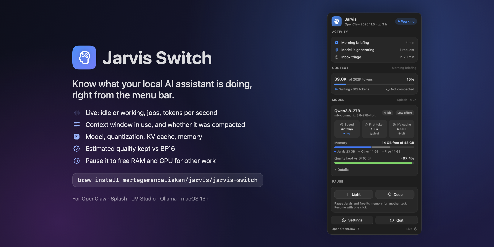
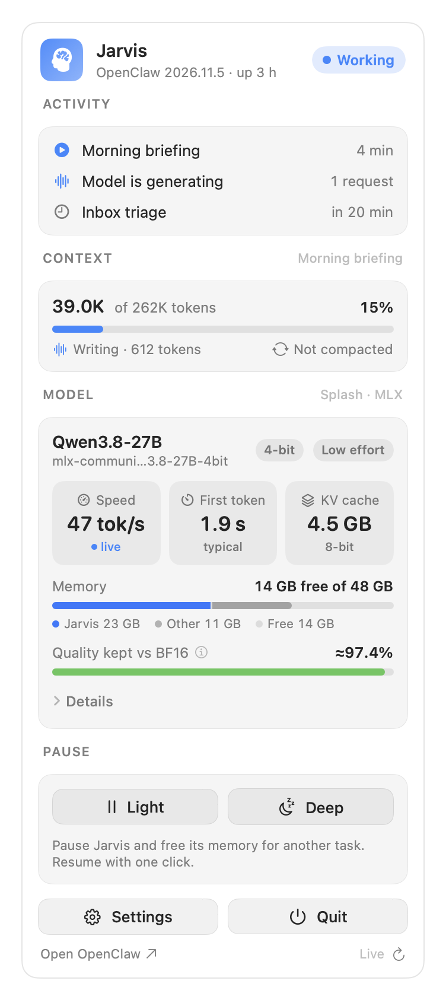
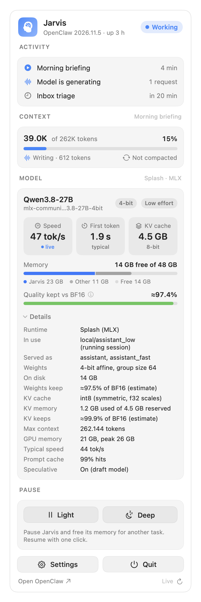
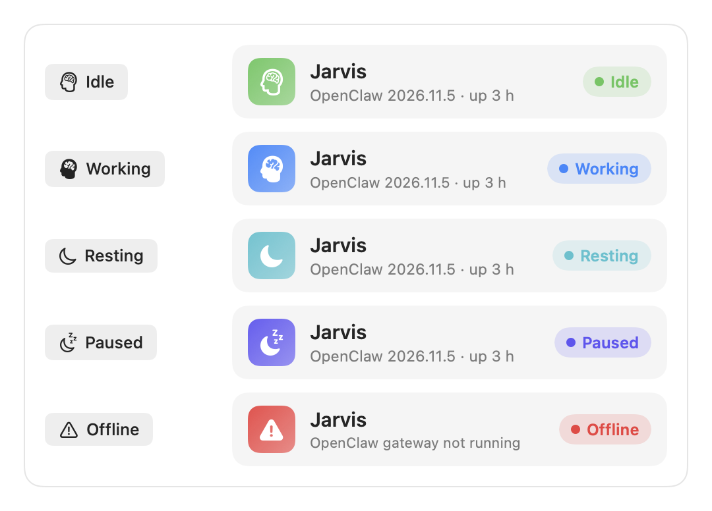
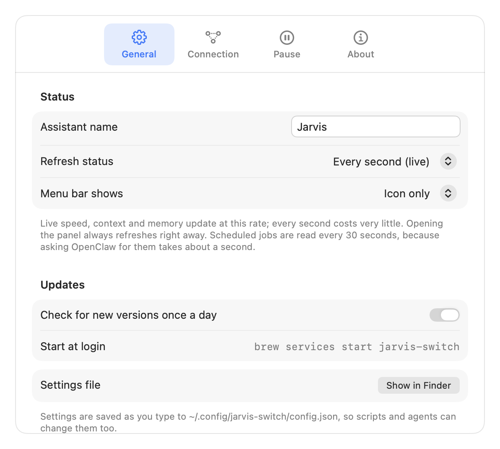
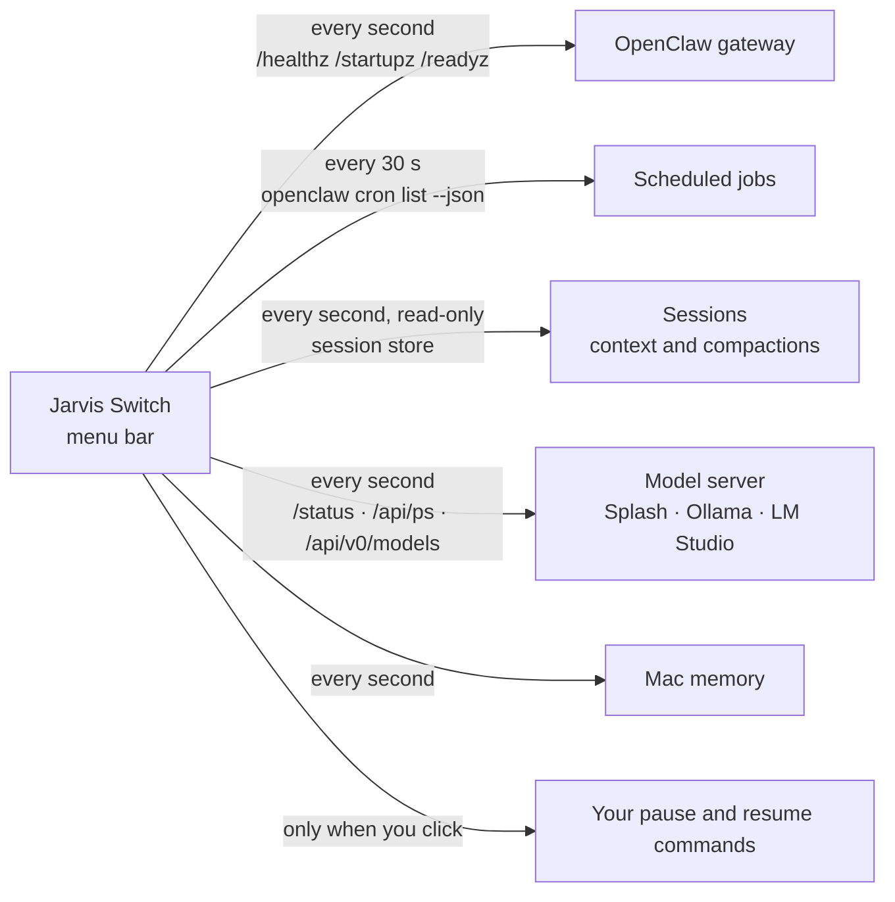

<p align="center">
  
</p>

<p align="center">
  <a href="https://github.com/mertegemencaliskan/jarvis-switch/releases"></a>
  <a href="https://github.com/mertegemencaliskan/jarvis-switch/actions/workflows/build.yml"></a>
  
  
  <a href="LICENSE"></a>
</p>

**Jarvis Switch** is a small, native macOS menu-bar app for people who run their own AI assistant on a Mac
with [OpenClaw](https://docs.openclaw.ai) and a local model. Click the icon and see, live:

- **Is it working?** Idle, working, resting, paused or offline; the jobs running now, the next one, and
  anything that failed.
- **How full is its head?** The active context window: tokens in use out of the window, whether it is
  reading the prompt or writing, and whether the conversation has been compacted.
- **How fast, and at what cost?** Live tokens per second, time to first token, and your Mac's memory split
  into the assistant, other apps and what is still free.
- **What exactly is loaded?** The model in use right now and its thinking effort (also with several
  models behind one router), its weight and KV-cache quantization, and an estimate of how much
  quality that quantization keeps compared with the full BF16 model.
- **Need the memory back?** Pause the assistant for a render or another big job, then resume it in one click.

Built for an assistant called Jarvis; the name is a setting.

## Install

### Ask your AI agent

Paste this to Claude Code, Codex or your own assistant:

```text
Install Jarvis Switch from https://github.com/mertegemencaliskan/jarvis-switch on this Mac.
Follow its AGENTS.md: install it with Homebrew, run `jarvis-switch --doctor` and fix what it reports
in ~/.config/jarvis-switch/config.json, set up the Pause commands for my model server, then start it
with `brew services start jarvis-switch` and show me `jarvis-switch --status`.
```

### Or yourself

```bash
brew install mertegemencaliskan/jarvis/jarvis-switch
brew services start jarvis-switch
```

Homebrew builds it from source on your Mac, so it needs the Xcode Command Line Tools
(`xcode-select --install`) and you get no "unidentified developer" warning. `brew services` starts it at
login. To update: `brew upgrade jarvis-switch && brew services restart jarvis-switch`. The panel tells you
when a new version is out.

## A closer look

<p align="center">
  <picture>
    <source media="(prefers-color-scheme: dark)" srcset="docs/panel-dark.png">
    
  </picture>
  &nbsp;&nbsp;
  <picture>
    <source media="(prefers-color-scheme: dark)" srcset="docs/panel-details-dark.png">
    
  </picture>
</p>

- **Activity**: only what matters right now, such as a job running for 4 minutes or the next job in 20 minutes.
- **Context**: the conversation the assistant is working in, how much of its context window is used,
  reading or writing, and compacted or not. While nothing runs it shows your main chat.
- **Model**: live speed, first-token time, KV-cache size and bits, Mac memory, and the estimated quality
  kept. **Details** adds weight quantization, size on disk, KV format, peak memory, prompt-cache hits and
  speculative decoding.
- **Pause**: Light (free the model's memory) or Deep (stop the model server), then Resume.

Everything refreshes every second by default; you can slow it down in Settings.

### The icon tells you the state

<p align="center">
  <picture>
    <source media="(prefers-color-scheme: dark)" srcset="docs/states-dark.png">
    
  </picture>
</p>

Optionally the menu bar shows the word too (Settings → General → Menu bar shows).

### Settings

<p align="center">
  <picture>
    <source media="(prefers-color-scheme: dark)" srcset="docs/settings-dark.png">
    
  </picture>
</p>

- **General**: the assistant's name, how often to refresh (every second up to every 15 minutes), icon only
  or icon and status in the menu bar, and the daily update check.
- **Connection**: the OpenClaw config, the `openclaw` command, and the gateway and model-server
  addresses. Leave a field empty to detect it; **Test connection** runs the same checks as `--doctor`.
- **Pause**: the commands behind Light, Deep and Resume.
- **About**: version, update check and links.

Settings are saved to `~/.config/jarvis-switch/config.json` (schema:
[`config.schema.json`](config.schema.json)) and picked up live, so you, a script or an agent can edit
the file too.

## How it works



| Model server | What it reports |
|---|---|
| **Splash (MLX)** | Everything: live requests and context, live speed, KV format and memory, process memory, memory pressure, prompt-cache hits, speculative decoding; weight quantization from the model folder |
| **Ollama** | Model, quantization level, memory, context length; KV type from `OLLAMA_KV_CACHE_TYPE` (f16 by default) |
| **LM Studio** | Model, quantization, context; LM Studio does not report its KV cache |
| **Any OpenAI-compatible server** | Model names; bit width guessed from the name |

Cloud models show their name only. Nothing leaves your Mac except the optional daily update check to
`api.github.com`, and the app never reads or sends your OpenClaw token or API keys.

## For agents and scripts

```bash
jarvis-switch --status --json     # live status as JSON
jarvis-switch --doctor --json     # setup checks with fixes; exit code 1 if something is broken
```

<details>
<summary>Example <code>--status --json</code> (abridged)</summary>

```json
{
  "state": "working",
  "jobs": { "running": [{ "name": "Morning briefing", "runningSeconds": 252 }], "next": { "name": "Inbox triage", "at": "2026-11-19T18:30:00Z" } },
  "context": { "session": "Morning briefing", "tokens": 39032, "windowTokens": 262144, "percent": 14.9, "phase": "Writing · 612 tokens", "compacted": false },
  "model": { "id": "mlx-community/Qwen3.8-27B-4bit", "runtime": "Splash (MLX)", "liveTokensPerSecond": 47, "estimatedQualityPercent": 97.4,
             "weights": { "bits": 4, "label": "4-bit affine, group size 64" }, "kvCache": { "bits": 8, "label": "int8 (symmetric, f32 scales)" } },
  "memory": { "totalBytes": 51539607552, "usedBytes": 36400000000, "assistantBytes": 24200000000 }
}
```

</details>

[`AGENTS.md`](AGENTS.md) has the full install and configuration guide for AI agents, and
[`llms.txt`](llms.txt) is a short summary for language models.

## About the quality estimates

These numbers are **rough, literature-based estimates, not measurements of your model**. They follow the
typical size of the quality loss reported for modern 7B–70B models:

| Weights | Est. quality kept | | KV cache | Est. quality kept |
|---|---|---|---|---|
| 16-bit (BF16/FP16) | 100% | | 16-bit | 100% |
| 8-bit | ≈99.7% | | 8-bit | ≈99.9% |
| 6-bit | ≈99.2% | | 4-bit | ≈99.0% |
| 5-bit | ≈98.6% | | lower | ≈96% |
| 4-bit | ≈97.5% | | | |
| 3-bit | ≈93% | | | |
| 2-bit | ≈82% | | | |

The real loss depends on the task. 4-bit models often match BF16 on reasoning and coding benchmarks, but
can lose much more on OCR-style and exact-transcription work. An 8-bit KV cache is close to lossless; a
4-bit one costs a little more at very long contexts. Treat the figures as a guide, and test your own workload.

## Pause commands

Jarvis Switch does not decide how to unload your model; it runs commands you choose in **Settings →
Pause** (directly, without a shell; quote arguments that contain spaces). For example, a light pause for
Ollama is `ollama stop MODEL`, and for Splash it is `curl -X POST http://127.0.0.1:8000/v1/memory/release`.
[`AGENTS.md`](AGENTS.md#pause-commands) has examples for each runtime, deep pauses and the optional JSON
replies. If your commands do not keep a "paused" marker file themselves, the app keeps one.

## Troubleshooting

- **Offline**: the OpenClaw gateway is not answering at the address in Settings → Connection. Start
  OpenClaw, or fix the address.
- **No jobs or context**: the `openclaw` command was not found, or it talks to a different OpenClaw
  setup. Point Settings → Connection at the command (or wrapper script) you use yourself.
- **No model details**: the model server is not running, or your default OpenClaw model is a cloud model.
- **Anything else**: run `jarvis-switch --doctor`; every problem comes with a hint.

## Development

```bash
scripts/build.sh                    # build/JarvisSwitch.app (Command Line Tools are enough)
scripts/screenshots.sh              # regenerate the images in docs/ with sample data
build/JarvisSwitch.app/Contents/MacOS/JarvisSwitch --status
```

Releases: add a `## X.Y.Z` section to [`CHANGELOG.md`](CHANGELOG.md), then `scripts/release.sh X.Y.Z`. It
tags, publishes the GitHub release and updates the formula in
[`homebrew-jarvis`](https://github.com/mertegemencaliskan/homebrew-jarvis).

Not affiliated with OpenClaw, Splash, LM Studio or Ollama. [MIT licensed](LICENSE).
